<div align="center">

<h1>SekaiPop</h1>

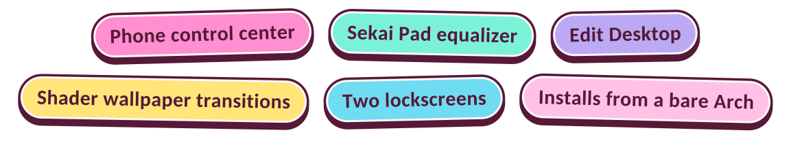

<br>

[Giới thiệu](#showcase) &nbsp;|&nbsp; [Điểm khác biệt](#different) &nbsp;|&nbsp; [Yêu cầu](#requirements) &nbsp;|&nbsp; [Cài đặt](#installation) &nbsp;|&nbsp; [Phím tắt](#keybinds) &nbsp;|&nbsp; [Khắc phục sự cố](#troubleshooting)

<br>

**[Read in English / Đọc bằng tiếng Anh](README.en.md)**

<br>

<div align="left">

> ⚠️ **Lưu ý**: Đây là bản dịch tiếng Việt dành cho [SekaiPop](https://github.com/Blapples/SekaiPop) Dotfiles của [Blapples](https://github.com/Blapples). Mình thấy dotfiles này rất tuyệt vời nên mình quyết định tạo bản Việt hóa cho nó (Vì bản gốc hiện vẫn chưa có chức năng thay đổi ngôn ngữ. 17/11/2026).

</div>

<div align="left">

> ⚠️ **Lưu ý: đây là một dự án đam mê, và phần lớn được viết theo kiểu "vibe coding".**
>
> Tôi tự thiết kế và định hướng SekaiPop: giao diện, UI, cách mọi thứ chuyển động và hoạt động. Claude viết phần lớn code để hiện thực hóa điều đó, nên hãy chuẩn bị tinh thần gặp các góc thô và lỗi vặt.

</div>

<br>

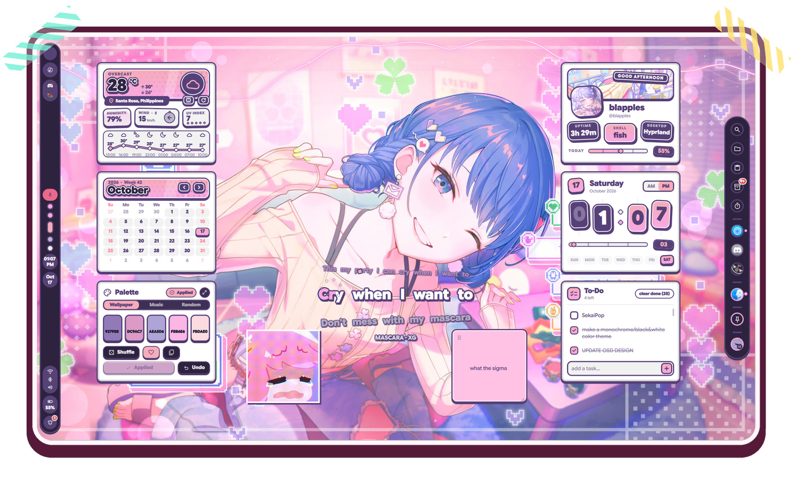

<sub>Đồng hồ, thời tiết, lịch, to-do, bảng màu, thẻ người dùng, ghi chú dán, lời bài hát và hình ảnh tùy chỉnh. Mọi widget đều có thể kéo thả, thay đổi kích thước và tắt bật tùy ý.</sub>

</div>

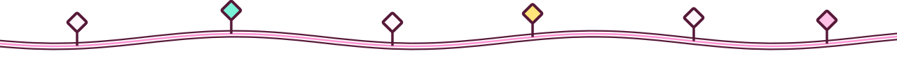

<h2 id="showcase">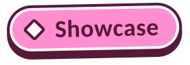</h2>

<table>
<tr>
<td width="50%" valign="top">
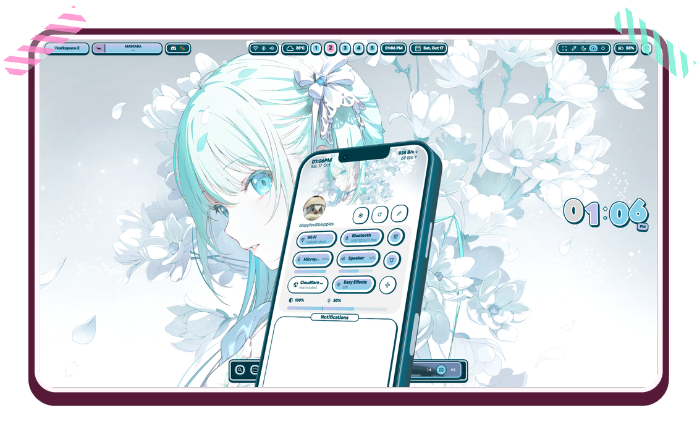
<br><b>Quick Panel: trung tâm điều khiển là một chiếc điện thoại</b><br>
Wi-Fi, Bluetooth, micro, loa, độ sáng màn hình, ánh sáng ban đêm, hiệu ứng âm thanh và thông báo nằm trên một chiếc điện thoại 2.5D bật lên từ cạnh dưới màn hình. Khi có thông báo mới, điện thoại trồi lên vừa đủ để hiển thị nó.
</td>
<td width="50%" valign="top">
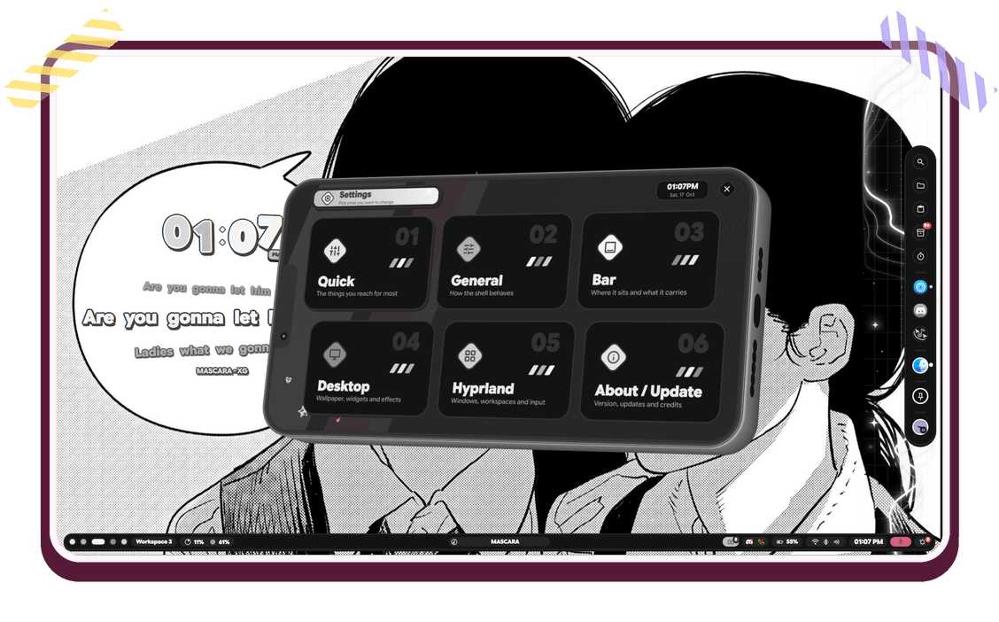
<br><b>Cài đặt: lật điện thoại sang ngang</b><br>
Cài đặt mở ra bằng cách xoay chiếc điện thoại Quick Panel sang chế độ ngang. Có sáu trang: Quick, General, Bar, Desktop, Hyprland và About / Update. Ảnh chụp ở chủ đề Monochrome.
</td>
</tr>
<tr>
<td width="50%" valign="top">
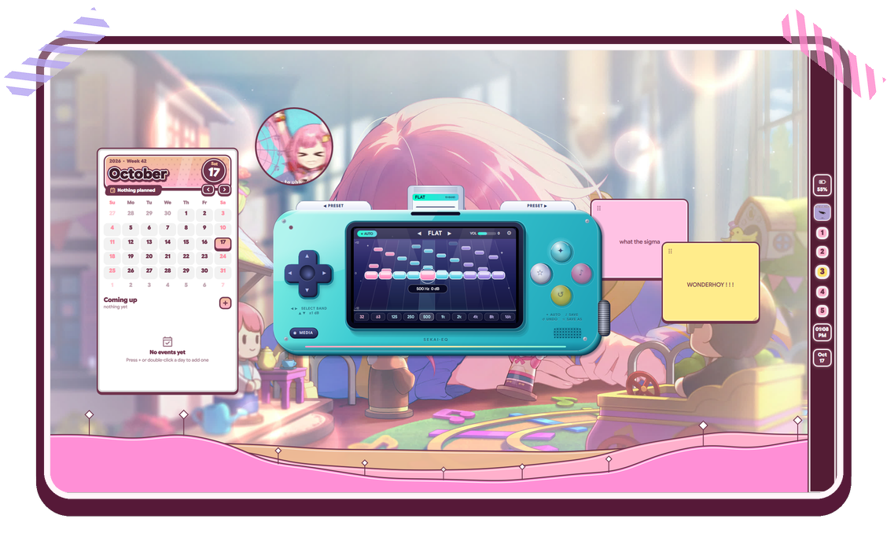
<br><b>Sekai Pad: bộ chỉnh âm là một máy chơi game cầm tay</b><br>
Bộ EQ 10 băng tần (EasyEffects) với D-pad để chọn băng tần, các nút mặt để lưu, hoàn tác và tự động, cùng các hộp băng preset có thể cắm vào phía trên.
</td>
<td width="50%" valign="top">
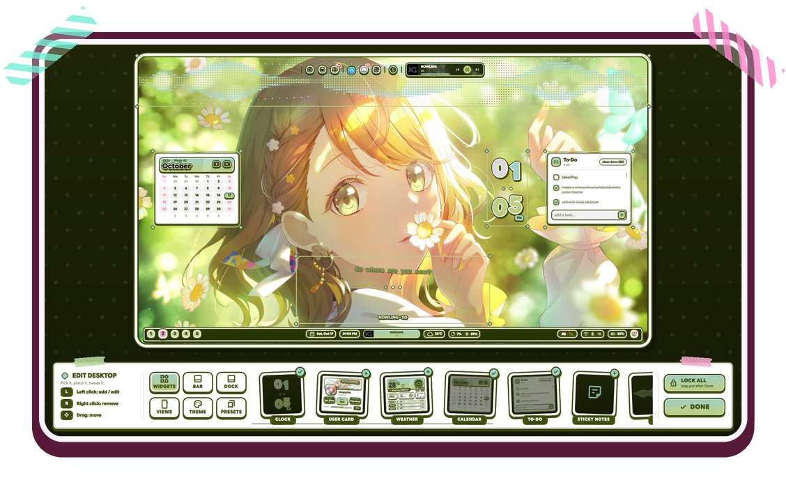
<br><b>Edit Desktop: sắp xếp lại như một cuốn scrapbook</b><br>
Nhấn <kbd>Super</kbd> + <kbd>Shift</kbd> + <kbd>E</kbd>. Click chuột trái để thêm hoặc chỉnh sửa, click chuột phải để xóa, kéo để di chuyển. Widget, bar, dock, chế độ xem, chủ đề và preset đều nằm ở đây.
</td>
</tr>
</table>


<h2 id="different">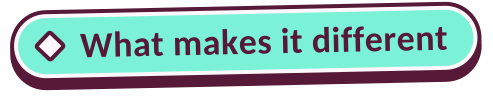</h2>

Hầu hết các shell chọn một giao diện rồi áp theme vào. SekaiPop bắt đầu từ một ngôn ngữ thiết kế thống nhất, áp dụng lên mọi thứ, và thêm vào một số ý tưởng riêng.

<table>
<tr>
<td width="50%" valign="top"><b>Một khối, ở khắp nơi</b><br>Mỗi viên thuốc, phím, thẻ và popup đều là một đường viền, một vòng kem mỏng, một lớp nền và một bóng đổ thẳng xuống, như một keycap chìm xuống khi nhấn. Không có gì trông như được ghép vào từ chỗ khác.</td>
<td width="50%" valign="top"><b>Shell là một chiếc điện thoại</b><br>Quick Panel, Cài đặt và trình khởi chạy ứng dụng đều là điện thoại. Cài đặt là chiếc điện thoại đó xoay sang ngang. Mọi thứ bật lên khi được bật và bị nuốt vào khi tắt, thay vì mờ dần.</td>
</tr>
<tr>
<td valign="top"><b>Sekai Pad</b><br>Bộ chỉnh âm được thiết kế như phần cứng thực: D-pad, các nút mặt, màn hình hiển thị đường cong trực tiếp và các hộp băng preset.</td>
<td valign="top"><b>Edit Desktop</b><br>Trình chỉnh sửa bố cục toàn màn hình được xây dựng từ cùng các khối đó, với các tab cho Widget, Bar, Dock, Views, Theme và Presets.</td>
</tr>
<tr>
<td valign="top"><b>Preset sống sót qua các bản cập nhật</b><br>Mặc một preset cũ không kéo theo các widget được thêm sau này. Kiểu màn hình khóa, đường dẫn thư mục và các lựa chọn riêng của máy được giữ nguyên. Mặc nhầm, hay lỡ xóa preset? Đều có Undo cho cả hai.</td>
<td valign="top"><b>Theme có cá tính</b><br>Sáu theme theo nhóm nhân vật (Virtual Singer, Leo/need, MORE MORE JUMP!, Vivid BAD SQUAD, Wonderlands×Showtime, Nightcord at 25:00), Monochrome, Wallpaper (matugen) và bảng màu Custom, mỗi cái có phiên bản Light, Dark và Darker. Chúng lan tới viền cửa sổ, màu sắc GTK, Qt và KDE, terminal và theme Vencord (Discord).</td>
</tr>
<tr>
<td valign="top"><b>Hiệu ứng chuyển hình nền bằng shader</b><br>Ring, Iris, Star (xoay tròn), Blocks, Flash, Fade và Random. Các dải che phủ toàn bộ màn hình rồi để lộ hình nền mới, theo màu theme của bạn. Cùng hiệu ứng chuyển đó được dùng khi vào và thoát màn hình khóa.</td>
<td valign="top"><b>Hai màn hình khóa</b><br>Gacha và Calendar: một poster với ba khung cắt từ hình nền, đồng hồ dưới dạng bốn keycap, một thẻ tháng và hai phím Khởi động lại / Tắt máy. Giữ <kbd>Ctrl</kbd> và Enter sẽ trở thành Sleep. Khi khóa, desktop ngủ: các widget được giải phóng, cava và hình nền video dừng lại, và mọi thứ thức dậy từng cái một khi mở khóa. Mở khóa bằng vân tay có sẵn khi <code>fprintd</code> được cài đặt và vân tay đã đăng ký (Cài đặt > General > Launcher & lock > Fingerprint unlock, mặc định tắt).</td>
</tr>
<tr>
<td valign="top"><b>Dock với các công cụ thực sự hữu ích</b><br>Tìm kiếm, Files (Nhạc, Ảnh, Video, Tài liệu, Thùng rác, với thumbnail video), Clipboard, Hẹn giờ, một thẻ media có thanh tua và Shelf: một khay kéo thả nơi các mục trở thành ảnh polaroid, đĩa vinyl, sách, thư mục và ghi chú dán bằng băng keo.</td>
<td valign="top"><b>Âm nhạc sống động</b><br>Một viên thuốc media với sóng âm trực tiếp, một widget visualizer cava, và một widget lời bài hát hỏi nhiều nhà cung cấp (LyricsPlus, NetEase, LRCLIB, QQ Music, Kugou), chọn cái tốt nhất cho từng bài, tô sáng từng từ và có bộ chọn nguồn.</td>
</tr>
<tr>
<td valign="top"><b>Discord voice</b><br>Một viên thuốc trên bar và popup hiển thị ai đang trong cuộc gọi, ai đang nói, tắt tiếng và bịt tai, thông qua một plugin Vencord nhỏ đi kèm. Tùy chọn; cần client Discord chính thức được vá bằng bộ cài Vencord độc lập, cộng với <code>git</code>, <code>node</code> và <code>pnpm</code>. Chạy <code>sekaipop/scripts/discordVoice/vencord-companion/install.sh</code> để thêm plugin.</td>
<td valign="top"><b>Cấu hình không cần file config</b><br>Kéo màn hình xung quanh bố cục Displays theo tỷ lệ thực và cài độ phân giải, tỷ lệ và tần số quét. Đặt bố cục bàn phím bằng bộ chuyển đổi trên bar. Mở cheatsheet tự xây dựng từ mô tả bind của Hyprland. Điều chỉnh ánh sáng ban đêm, gamma và độ sáng, và nhận popup reload hiển thị lỗi shell.</td>
</tr>
<tr>
<td valign="top"><b>Desktop đầy đủ tính năng</b><br>Hiển thị trên màn hình, hộp thoại polkit, thông báo, chụp màn hình (vùng chọn, OCR vào clipboard, Google Lens, quay màn hình, chọn màu), Game Mode, Focus Mode, Overview, bàn phím ảo và hướng dẫn chào mừng. Bar và dock hoạt động ở bất kỳ cạnh nào theo bốn kiểu: Float, Straight, Transparent và Capsule.</td>
<td valign="top"><b>Trình cài đặt cho hệ thống trần</b><br><code>./install.sh</code> biến một bản Hyprland tối giản thành desktop hoàn chỉnh: gói phần mềm, font chữ, dịch vụ, nhóm người dùng, shell và một cấu hình Hyprland sẵn dùng, có sao lưu và khôi phục bằng một lệnh.</td>
</tr>
</table>


<h2 id="requirements">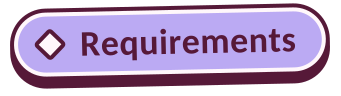</h2>

| Yêu cầu | Ghi chú |
|---|---|
| **Distro dựa trên Arch** (Arch, CachyOS, EndeavourOS) | Trình cài đặt dùng `pacman` và AUR |
| **Hyprland 0.55+** | Cấu hình dùng **Lua** (`hyprland.lua`); các phiên bản cũ hơn không đọc được |
| **Quickshell** | `quickshell` hoặc `quickshell-git` |
| **Qt 6.7+** | Shader đi kèm được build cho Qt 6.12. Trên Qt cũ hơn, trình cài đặt tự build lại một lần (cần `qt6-shadertools`) |
| **Người dùng thường có `sudo`** | Không chạy trình cài đặt với quyền root |
| **AUR helper** (`yay` hoặc `paru`) | Trình cài đặt có thể build `yay-bin` cho bạn nếu chưa có |

> [!IMPORTANT]
> Driver GPU **không bao giờ** bị trình cài đặt động vào. Hãy tự cài driver của bạn (đặc biệt là NVIDIA) trước khi bắt đầu.

<details>
<summary><b>Gói cơ bản</b> (shell không thể khởi động nếu thiếu)</summary>
<br>

`hyprland` `quickshell` `qt6-base` `qt6-declarative` `qt6-multimedia-ffmpeg` `qt6-svg` `qt6-imageformats` `qt6-wayland` `qt6-shadertools` `dbus` `polkit` `mesa` `pipewire` `wireplumber` `pipewire-pulse` `libpulse` `networkmanager` `bluez` `bluez-utils` `upower` `power-profiles-daemon` `libnotify` `wl-clipboard` `jq` `curl` `git` `xdg-utils` `xdg-user-dirs` `fontconfig` `python` `python-numpy` `ttf-material-symbols-variable`

</details>

<details>
<summary><b>Gói tính năng</b></summary>
<br>

| Dành cho | Gói |
|---|---|
| Theme | `matugen` `adw-gtk-theme` `dconf` `glib2` `xorg-xrdb` |
| Âm nhạc | `cava` `easyeffects` |
| Chụp màn hình, OCR, quay màn hình | `grim` `slurp` `swappy` `tesseract` `tesseract-data-eng` `imagemagick` `wf-recorder` `ffmpeg` `hyprpicker` |
| Clipboard, emoji, gõ phím | `cliphist` `wtype` |
| Ánh sáng ban đêm, độ sáng | `hyprsunset` `brightnessctl` `ddcutil` |
| Hộp thoại, terminal | `zenity` `kitty` |
| Nút "Advanced" Wi-Fi / Bluetooth | `plasma-nm` `kde-cli-tools` `blueman` |
| Âm thanh, cập nhật | `libcanberra` `sound-theme-freedesktop` `pacman-contrib` |
| Phím media | `playerctl` |

</details>

<details>
<summary><b>Desktop layer</b> (bỏ qua với <code>--no-desktop-layer</code> nếu bạn đã có desktop)</summary>
<br>

`xorg-xwayland` `xdg-desktop-portal` `xdg-desktop-portal-hyprland` `xdg-desktop-portal-gtk` `gvfs` `adwaita-icon-theme` `noto-fonts` `noto-fonts-cjk` `noto-fonts-emoji` `ttf-jetbrains-mono-nerd` `gnome-keyring` `libsecret` `pipewire-alsa`, cộng thêm một trình quản lý file (Dolphin trên KDE, Thunar cho các trường hợp khác) và `qt6ct` khi không có gì khác theme Qt.

Các portal là thứ cho phép chia sẻ màn hình hoạt động trong Discord, trình duyệt và OBS.

</details>

<details>
<summary><b>Tùy chọn</b> (<code>--with-optional</code>)</summary>
<br>

`python-aubio` `songrec` (nhận diện bài hát), `mpvpaper` (hình nền video), `nwg-displays`, `hypridle`, `nodejs` `pnpm` (build plugin Vencord), `cloudflare-warp-bin`

</details>

<details>
<summary><b>Font chữ và dịch vụ</b></summary>
<br>

**Font chữ:** Google Sans Flex (trình cài đặt tải vào `~/.local/share/fonts`) và Material Symbols Rounded cho icon.

**Dịch vụ được trình cài đặt bật lên:** `NetworkManager`, `bluetooth`, `upower`, `power-profiles-daemon`, và các dịch vụ PipeWire của người dùng (`pipewire`, `pipewire-pulse`, `wireplumber`). Bạn cũng được thêm vào nhóm `video`.

</details>


<h2 id="installation">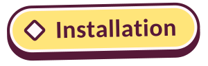</h2>

### 1. Cài đặt

```bash
curl -fsSL https://raw.githubusercontent.com/Blapples/SekaiPop/main/get.sh | bash
```

Đây là toàn bộ quá trình cài đặt. Lệnh này tải SekaiPop về rồi thực hiện ba việc:

1. **Phụ thuộc:** gói phần mềm (repo và AUR), Google Sans Flex, dịch vụ, nhóm người dùng.
2. **Shell:** sao chép vào `~/.config/quickshell/sekaipop` (bản cũ được giữ lại dưới dạng `.bak-<thời_gian>`).
3. **Hyprland:** một cấu hình Lua sẵn dùng trong `~/.config/hypr` (phím tắt, rules, autostart, khóa màn hình khi idle) và một `monitors.lua` được tạo cho các màn hình đang kết nối. Trong Hyprland đang chạy, nó chọn tần số quét cao nhất màn hình hỗ trợ ở độ phân giải ưu tiên.

> [!WARNING]
> Chạy với tư cách người dùng thường, không phải root. Lệnh sẽ tự gọi `sudo` khi cần.

Muốn xem trước? Thêm `--dry-run`: lệnh sẽ in ra tất cả những gì nó sẽ làm mà không thay đổi gì.

```bash
curl -fsSL https://raw.githubusercontent.com/Blapples/SekaiPop/main/get.sh | bash -s -- --dry-run
```

Các tùy chọn đặt sau lệnh (xem [Tùy chọn trình cài đặt](#installer-options)), ví dụ `--yes` hoặc `--hypr merge`.

<details>
<summary>Muốn tự clone về?</summary>

```bash
git clone https://github.com/Blapples/SekaiPop.git
cd SekaiPop
./install.sh --dry-run      # xem trước
./install.sh                # cài đặt
```

```
install.sh   install-deps.sh   check-deps.sh
hypr/        cấu hình Hyprland (Lua)
sekaipop/    bản thân shell
```

</details>

### 2. Khởi động

Đăng xuất và đăng nhập lại, chọn phiên **Hyprland** thuần túy (**không** chọn "uwsm"). Shell sẽ tự khởi động. Trong Hyprland đang chạy, trình cài đặt sẽ hỏi bạn có muốn reload và khởi động nó không.

### 3. Kiểm tra mọi thứ

```bash
curl -fsSL https://raw.githubusercontent.com/Blapples/SekaiPop/main/get.sh | bash -s -- --check
```

Lệnh này chỉ đọc: liệt kê những gì đã được cài và những gì còn thiếu, không thay đổi gì.

### Tùy chọn trình cài đặt

<a id="installer-options"></a>

| Tùy chọn | Chức năng |
|---|---|
| `--dry-run` | Hiển thị tất cả, không thay đổi gì |
| `--yes` | Không hỏi xác nhận |
| `--hypr full` | Cài cấu hình Hyprland được cấu hình sẵn (mặc định khi cài mới) |
| `--hypr merge` | **Giữ nguyên cấu hình của bạn**, chỉ thêm file `sekaipop_session` nhỏ |
| `--hypr skip` | Không động vào Hyprland |
| `--no-deps` | Chỉ sao chép file, không cài gói |
| `--rice DIR` | Cài một bản sao khác của thư mục `sekaipop` |
| `--restore` | Khôi phục cấu hình Hyprland được sao lưu bởi lần chạy trước |
| `-- <tùy chọn>` | Truyền tùy chọn cho `install-deps.sh` |

Tùy chọn thêm của `install-deps.sh` (truyền sau `--`): `--core-only`, `--with-optional`, `--no-desktop-layer`, `--gpu amd|intel|nvidia|skip`, `--ddc`, `--file-manager dolphin|thunar|none`, `--no-update`, `--no-aur`.

```bash
./install.sh --hypr merge                          # Tôi đã có cấu hình Hyprland
./install.sh -- --with-optional --gpu amd          # mọi thứ, GPU AMD
./install.sh --yes -- --core-only                  # tối thiểu, không hỏi
```

### An toàn

- Cấu hình Hyprland cũ của bạn được chuyển sang `~/.config/hypr.sekaipop-backup-<thời_gian>`, **không bao giờ bị xóa**. `./install.sh --restore` sẽ khôi phục lại.
- `monitors.lua`, `workspaces.lua`, `sekaipop_overrides.lua` và thư mục `custom/` của bạn được giữ nguyên.
- `monitors.lua` **không bao giờ được đóng gói sẵn**. File này được tạo ra cho màn hình của bạn, nên cấu hình viết cho màn hình của người khác không thể khiến bạn nhìn thấy màn hình đen.
- Lỗi trong bất kỳ file cấu hình nào được ghi vào `~/.cache/sekaipop/hypr-errors.log`; các file còn lại vẫn tải bình thường.

### Cập nhật

Chạy lại lệnh cài đặt. Cài đặt và trạng thái nằm trong `~/.local/state/sekaipop`, nên các lựa chọn của bạn được giữ nguyên. Nếu bạn đã clone repo, hãy `git pull` và chạy lại `./install.sh`.

### Thay đổi theo ý riêng

Chỉnh sửa các file trong `~/.config/hypr/custom/` (`keybinds.lua`, `rules.lua`, `variables.lua`, `env.lua`, `execs.lua`, `general.lua`). Chúng được tải sau cấu hình mặc định và không bao giờ bị ghi đè. Đặt cho một phím tắt mô tả như `"Apps: Thứ gì đó của tôi"` và cheatsheet sẽ liệt kê nó.

### Plugin

Một plugin là một widget desktop, một mục trên bar với thẻ bên dưới, hoặc cả hai, được đặt trong thư mục riêng, thường là repo riêng: đặt vào `~/.config/sekaipop/plugins/` (hầu hết có `install.sh` làm việc đó), chạy `qs -c sekaipop ipc call plugins reload`, rồi thêm widget của nó từ Edit Desktop và bật mục bar của nó trong Settings > Bar > Modules. Plugin chạy với toàn quyền của shell, nên chỉ cài những gì bạn sẵn sàng chạy như script của chính mình. Hướng dẫn viết plugin và giao diện nó nhận được: [Plugins](docs/PLUGINS.md); các ví dụ nhỏ nhất là [hello clock](examples/plugins/hello-clock/) (một widget) và [hello bar](examples/plugins/hello-bar/) (một mục bar).

<!-- plugin-list -->
| Plugin | Tính năng thêm vào |
| ------ | ------------ |
| [Tailscale](https://github.com/masshirodev/sekaipop-tailscale) | Mục bar hiển thị máy này có trên tailnet không và bao nhiêu thiết bị đang hoạt động (`5/6`); click để liệt kê mọi thiết bị kèm chấm trạng thái và sao chép IP. Danh sách tương tự dưới dạng widget desktop. |
<!-- /plugin-list -->

Tự làm được plugin? Gắn topic GitHub [`sekaipop-plugin`](https://github.com/topics/sekaipop-plugin) cho repo và mở pull request thêm nó vào danh sách trên.


<h2 id="keybinds"></h2>

Nhấn <kbd>Super</kbd> + <kbd>/</kbd> bất cứ lúc nào để xem danh sách đầy đủ theo nhóm.

Để thay đổi, mở **Settings > Hyprland > Keybinds** (hoặc `qs -c sekaipop ipc call keybinds toggle`): một sơ đồ bàn phím hiển thị những gì đang gắn với mỗi phím. Chọn một hành động, nhấn **Press keys**, rồi nhấn các phím mới (hoặc bật/tắt modifier và click phím trên sơ đồ). Thay đổi có hiệu lực ngay, và **Reset** sẽ khôi phục lại.

| Phím | Hành động |
|---|---|
| <kbd>Super</kbd> (nhấn) hoặc <kbd>Super</kbd> + <kbd>A</kbd> | Ứng dụng (điện thoại launcher) |
| <kbd>Super</kbd> + <kbd>N</kbd> | Quick Panel |
| <kbd>Super</kbd> + <kbd>Tab</kbd> | Overview |
| <kbd>Super</kbd> + <kbd>I</kbd> | Cài đặt |
| <kbd>Super</kbd> + <kbd>/</kbd> | Cheatsheet |
| <kbd>Super</kbd> + <kbd>K</kbd> | Bàn phím ảo |
| <kbd>Super</kbd> + <kbd>M</kbd> | Bộ chỉnh âm (Sekai Pad) |
| <kbd>Super</kbd> + <kbd>G</kbd> | Game Mode |
| <kbd>Super</kbd> + <kbd>Shift</kbd> + <kbd>E</kbd> | Edit Desktop |
| <kbd>Super</kbd> + <kbd>Shift</kbd> + <kbd>F</kbd> | Focus Mode |
| <kbd>Ctrl</kbd> + <kbd>Super</kbd> + <kbd>T</kbd> | Chọn hình nền |
| <kbd>Ctrl</kbd> + <kbd>Super</kbd> + <kbd>Alt</kbd> + <kbd>T</kbd> | Hình nền ngẫu nhiên |
| <kbd>Ctrl</kbd> + <kbd>Super</kbd> + <kbd>Shift</kbd> + <kbd>T</kbd> | Chọn theme |
| <kbd>Ctrl</kbd> + <kbd>Super</kbd> + <kbd>Shift</kbd> + <kbd>D</kbd> | Chuyển đổi chế độ tối |
| <kbd>Ctrl</kbd> + <kbd>Super</kbd> + <kbd>R</kbd> | Khởi động lại shell |
| <kbd>Super</kbd> + <kbd>L</kbd> | Khóa màn hình |
| <kbd>Super</kbd> + <kbd>Shift</kbd> + <kbd>S</kbd> | Chụp vùng chọn |
| <kbd>Super</kbd> + <kbd>Shift</kbd> + <kbd>X</kbd> | Nhận dạng ký tự (OCR) vào clipboard |
| <kbd>Super</kbd> + <kbd>Shift</kbd> + <kbd>A</kbd> | Google Lens |
| <kbd>Super</kbd> + <kbd>Shift</kbd> + <kbd>R</kbd> | Quay vùng chọn |
| <kbd>Super</kbd> + <kbd>V</kbd> / <kbd>Super</kbd> + <kbd>.</kbd> | Lịch sử clipboard / emoji |

Các phím âm lượng và độ sáng được xử lý qua màn hình hiển thị trên screen của shell.


<h2 id="troubleshooting">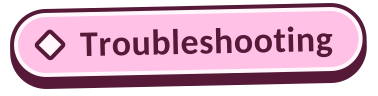</h2>

| Vấn đề | Thử làm |
|---|---|
| Shell không khởi động | Chạy `qs -c sekaipop log`, và đảm bảo bạn đã đăng nhập vào phiên **Hyprland** thuần túy, không phải uwsm |
| "Failed to load configuration" sau cập nhật ("... is not a type" cho thứ gì đó file khai báo) | Khởi động lại shell, đừng reload: **Restart shell** trên thẻ lỗi, hoặc `qs kill -c sekaipop; qs -c sekaipop -d`. Reload vẫn ở trong cùng tiến trình, có thể giữ lại trạng thái của file cũ (issue #79) |
| Màn hình đen sau khi cài | `./install.sh --restore`, rồi đọc `~/.cache/sekaipop/hypr-errors.log` |
| Icon bị thiếu | Cài `ttf-material-symbols-variable`, rồi `fc-cache -f` |
| Shader hoặc hiệu ứng chuyển không hiển thị | Qt cũ hơn 6.12 cần build lại shader: `bash ~/.config/quickshell/sekaipop/shaders/compile-shaders.sh` (cần `qt6-shadertools`) |
| Hyprland từ chối một phần cấu hình | `hyprctl configerrors` hiển thị những gì nó từ chối tải |
| Có gì đó bị thiếu | Chạy `./check-deps.sh`; nó liệt kê mọi gói và module QML còn thiếu |


<h2 id="credits">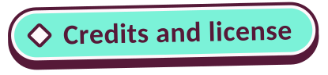</h2>

> [!CAUTION]
> Hành động **search** của bộ chọn vùng sẽ tải ảnh chụp đã cắt lên `uguu.se` trước khi mở Google Lens. Đừng dùng nó với nội dung riêng tư.

SekaiPop được xây dựng trên công sức của nhiều người, và tôi biết ơn tất cả họ.

**Nền tảng**

- **[end4](https://github.com/end-4)** và [dots-hyprland](https://github.com/end-4/dots-hyprland) (Illogical Impulse): nền tảng của toàn bộ shell này. Cấu hình Hyprland trong `hypr/` được phỏng theo, trình cài đặt theo ý tưởng của `./setup install`, và các shader Anti-Flashbang được sao chép nguyên vẹn (GPL-3.0). Cheatsheet, Overview và cách tổ chức Settings cũng học theo.
- **[pCtrade](https://github.com/pctrade)** (end4-pC): nguồn cảm hứng cho mức độ tùy biến của shell này, và vì sự hỗ trợ của anh ấy trong suốt quá trình. Các visualizer âm thanh `aurora`, `dots`, `mirror` và `ring` được port từ công việc của anh.
- Fork Illogical Impulse của **[p3dro](https://github.com/P3DROVFX)**: dịch vụ Discord Voice mà viên thuốc bar và popup được port từ đó.
- **[ilyamiro](https://github.com/ilyamiro)** và shell Serpentium của anh: engine bộ chỉnh âm đằng sau Sekai Pad. Backend EasyEffects 10 băng tần (`equalizer.sh`) đến với SekaiPop qua fork pC, và màn hình chào mừng theo cấu trúc `Start.qml` của anh. Thiết kế máy chơi game cầm tay của Sekai Pad là sáng tạo riêng của SekaiPop.

**Các dự án được sử dụng**

- [Quickshell](https://quickshell.org) và [Hyprland](https://hyprland.org), nền tảng chạy shell này.
- [matugen](https://github.com/InioX/matugen) của InioX, để lấy màu từ hình nền.
- Material Discord của CapnKitten và system24 của refact0r, nền tảng của theme Discord.
- [emojibase](https://github.com/milesj/emojibase) (MIT), dữ liệu emoji cho launcher.
- Material Symbols (icon) và Google Sans Flex (văn bản).
- [hyprland-scroll-overview](https://github.com/yayuuu/hyprland-scroll-overview) của yayuuu, một plugin tùy chọn shell có thể dùng.
- [Open-Meteo](https://open-meteo.com) cho thời tiết, và LRCLIB, LyricsPlus, NetEase Cloud Music, QQ Music và Kugou cho lời bài hát.

Vì có chứa code GPL-3.0, **repository này được phân phối theo GPL-3.0**. Xem [LICENSE](LICENSE).

Các theme và tên nhân vật là tham chiếu fan đến *Project SEKAI COLORFUL STAGE! feat. Hatsune Miku*. Đây là dự án fan không chính thức, không liên kết với SEGA, Colorful Palette hay Crypton Future Media. Hình nền trong ảnh chụp màn hình thuộc về các họa sĩ gốc.


